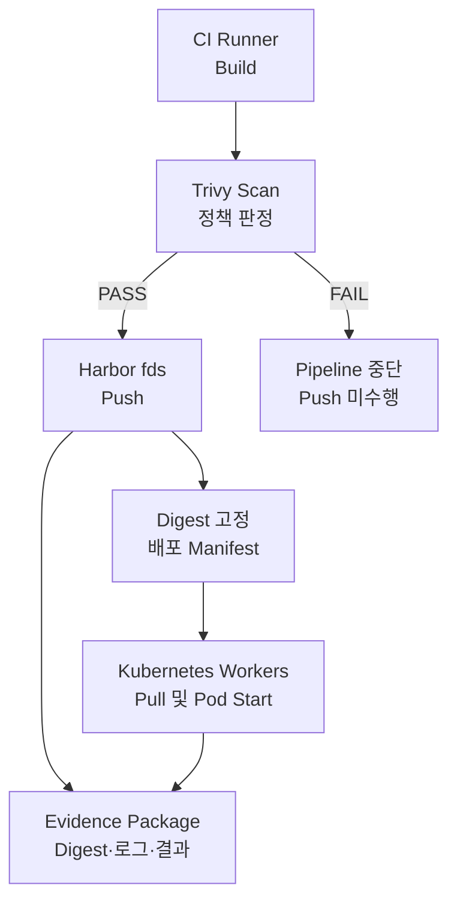

# infra-harbor-trivy

Harbor 기반 Private Registry와 Trivy CI Scan Gate를 구축·검증하고, `P1-HBR-01` Acceptance Criteria와 실행 증적을 추적하기 위한 인프라 저장소입니다.

> 이 저장소의 문서는 구현 가이드이며 정본 자체가 아닙니다. 범위·Acceptance Criteria·정책이 충돌할 경우 `fds-project-baseline`의 최신 RELEASED 정본과 승인된 Decision Record를 우선합니다.

## 1. 저장소 목적

이 저장소는 다음 항목을 버전 관리합니다.

- Harbor 설치·설정 템플릿과 운영 Runbook
- Private CA 기반 TLS 적용 및 신뢰 구성
- `fds` Private Project와 Robot Account 최소권한 구성
- Runner의 인증 Push/Pull과 Worker의 Pull-only 연동
- CI Trivy Scan Gate와 Image Digest 추적 절차
- P1-HBR-01 검증 스크립트 및 증적 인덱스
- 장애 복구, Rollback, 보안 예외 및 변경 이력

운영 중 생성되는 원본 증적은 별도 Evidence 저장소에서 관리합니다. 이 저장소에는 증적의 위치, SHA-256, 실행 시각, 실행 주체, 관련 AC와 같은 추적 정보만 커밋합니다.

## 2. 정본과 책임 경계

| 구분 | 위치 | 역할 |
| --- | --- | --- |
| 요구사항·AC 정본 | [`321Team/fds-project-baseline`](https://github.com/321Team/fds-project-baseline) | 최신 RELEASED 범위, AC, Interface, Decision의 최종 기준 |
| Harbor·Trivy 구현 | `321Team/infra-harbor-trivy` | 구성, 스크립트, Runbook, 검증 자동화 |
| 실행 증적 원본 | [`321Team/fds-project-evidence`](https://github.com/321Team/fds-project-evidence) | Sanitized 로그, 결과, 화면 캡처, 증적 무결성 파일 |
| 연동 구현 | 관련 인프라 저장소 | CI Runner, Kubernetes, 보안, DR 영역별 실제 구성 |

적용 우선순위는 다음과 같습니다.

1. 최신 RELEASED Baseline
2. 승인된 Decision/Exception Record
3. 승인된 Ticket/Change Request
4. 이 저장소의 README·Runbook·스크립트

README나 예시 값만으로 정책을 확정하지 않습니다. 미승인 항목은 반드시 `Proposed`, `Approval Pending` 또는 `NOT VERIFIED`로 표시합니다.

## 3. P1 대상 구성

| 역할 | Canonical 대상 | 허용 동작 |
| --- | --- | --- |
| Harbor | `harbor01` / `10.1.93.54:443` | Private Registry 제공 |
| Project | `fds` | Private Project |
| CI Runner | `cicd-runner01` / `10.250.10.20` | 인증 Push + Pull |
| Worker 1 | `k8s-worker01` / `10.1.93.105` | 인증 Pull, Push DENY |
| Worker 2 | `k8s-worker02` / `10.1.93.107` | 인증 Pull, Push DENY |
| Worker 3 | `k8s-worker03` / `10.1.93.108` | 인증 Pull, Push DENY |

P1에서는 Harbor 단일 노드와 로컬 저장소를 사용합니다. 다음 항목은 최신 정본 또는 별도 승인 없이는 이 저장소의 P1 완료 범위로 간주하지 않습니다.

- Harbor HA 및 외부 Object Storage
- Admission Policy에 의한 Registry 강제
- Image Signature Verification
- 시스템 Image의 Harbor 경유 정책
- Harbor 내부 Scanner 또는 CI-only Scan 모델의 최종 선택

## 4. 처리 흐름



최종 배포 Image는 Tag가 아니라 승인된 Digest로 고정합니다.

```yaml
image: 10.1.93.54/fds/<repository>@sha256:<approved-digest>
```

## 5. 범위

### 포함

- Harbor 서비스 설치 및 자동복구 검증
- DEC-P1-TLS-01(D19)에 따른 Private CA Leaf 인증서 적용
- `10.1.93.54` IP SAN과 인증서 Chain 검증
- Runner·Worker의 OS/Container Runtime CA Trust 구성
- `fds` Private Project 생성 및 Anonymous Pull/Push 차단
- Runner Push+Pull Robot과 Worker Pull-only Robot 분리
- Host Firewall Source Allowlist와 실제 관측 Source IP 대조
- Trivy 결과와 Harbor Artifact Digest 연계
- Worker 3대별 Pull, Pod Start, Digest, Push DENY 검증
- 이전 승인 Digest를 이용한 Rollback 검증
- AC별 Evidence Matrix와 SHA-256 무결성 검증

### 제외 또는 별도 승인 필요

- Harbor HA 및 외부 Storage
- Kyverno/OPA 기반 Admission Enforcement
- Image Signing 및 Signature 검증
- 미승인 Robot Token 무기한 정책
- 미승인 HIGH/CRITICAL Threshold
- 미승인 Harbor Scanner 제외 또는 CI-only Scan 모델
- OID-02 대상 시스템 Image 처리 방식

## 6. 권장 저장소 구조

아래 구조를 기준으로 파일을 추가합니다. 디렉터리가 아직 없는 경우 해당 작업 PR에서 필요한 범위만 생성합니다.

```text
.
├── .github/
│   ├── workflows/                 # Lint, test, secret scan 등
│   ├── CODEOWNERS
│   └── pull_request_template.md
├── config/
│   ├── harbor/                    # Sanitized Harbor 설정 템플릿
│   ├── containerd/                # Worker CA/hosts 설정 템플릿
│   └── trivy/                     # 승인된 Scan 정책 설정
├── scripts/
│   ├── install/                   # 설치·구성 자동화
│   ├── verify/                    # Positive/Negative 검증
│   └── evidence/                  # 증적 정리·해시 생성
├── tests/                         # 정적·통합 검증
├── docs/
│   ├── runbooks/                  # 구축·운영·복구 절차
│   ├── decisions/                 # 승인된 Decision 링크/사본
│   ├── evidence-index/P1-HBR-01/  # 원본 증적 링크와 해시
│   └── reviews/                   # 리뷰 판정과 조치 결과
├── .gitignore
├── CONTRIBUTING.md
├── SECURITY.md
└── README.md
```

## 7. 구현 순서

### 7.1 시작 전 확인

1. 최신 RELEASED Baseline과 P1-HBR-01 AC를 확인합니다.
2. Endpoint, Host, Source IP, Owner가 정본과 일치하는지 확인합니다.
3. 미결 Decision과 선행 Interface의 상태를 확인합니다.
4. 작업용 Branch와 Evidence Run ID를 생성합니다.
5. 운영 영향이 있는 재시작·Firewall 변경은 승인된 Change 절차를 따릅니다.

### 7.2 구축 및 검증

1. Harbor Compose Stack과 Health API를 확인합니다.
2. Private CA Leaf 인증서와 `10.1.93.54` IP SAN을 검증합니다.
3. Runner와 Worker 3대의 CA Trust를 각각 확인합니다.
4. `fds` Private Project와 역할별 Robot Account를 구성합니다.
5. Runner Push/Pull, Anonymous Pull/Push DENY를 검증합니다.
6. Worker 3대 각각에서 Pull, Pod Ready, Digest 일치, Push DENY를 검증합니다.
7. Trivy Gate의 PASS/FAIL과 실패 시 Push 미수행을 검증합니다.
8. CI → Harbor → Manifest → Pod의 Digest 4/4 일치를 검증합니다.
9. 이전 승인 Digest로 Rollback 후 Pod Start와 Health를 확인합니다.
10. AC Evidence Matrix와 `99_SHA256SUMS.txt`를 생성합니다.

## 8. P1-HBR-01 Acceptance Criteria Gate

| Gate | 필수 판정 | 최소 Evidence |
| --- | --- | --- |
| AC-01 Service/TLS | Harbor Health와 Certificate Chain PASS | Compose 상태, Health 응답, SAN/Chain 결과, 재기동 후 Push/Pull |
| AC-02 IF-09 Runner | 인증 Push/Pull ALLOW, Anonymous DENY | Runner 실행 로그, Exit Code, Harbor 로그, 실제 Source IP |
| AC-03 IF-10 Workers | 3대 모두 Pull/Pod Start ALLOW, Push DENY | 노드별 CRI 결과, Pod Ready/Event, `imageID`, 권한 거부 로그 |
| AC-04 Network Boundary | 실제 Source IP와 Firewall Allowlist 일치 | 적용 Rule, Harbor/Nginx 관측 로그, 비승인 Source DENY |
| AC-05 Traceability | Digest와 Scan 결과의 동일 Artifact 연계 | CI Digest, Harbor Digest, Manifest Digest, Pod `imageID`, Scan 메타데이터 |
| AC-06 Credential Safety | 평문·복원 가능한 Secret 0건 | Secret scan 결과, Masking 확인, Credential fingerprint |

검증을 실행하지 않았거나 원본 증적이 없으면 `PASS`가 아니라 `NOT VERIFIED`로 기록합니다. 다른 Host의 대표 결과로 Worker 3대 검증을 대체할 수 없습니다.

## 9. Evidence 관리

원본 증적의 Canonical 경로는 Evidence 저장소의 다음 구조를 권장합니다.

```text
docs/evidence/P1-HBR-01/
├── 00_run_metadata/
├── 01_service_health/
├── 02_tls_trust/
├── 03_if09_runner/
├── 04_if10_workers/
├── 05_firewall_source/
├── 06_trivy_digest/
├── 07_credential_control/
├── 08_rollback/
├── AC_Evidence_Matrix.md
└── 99_SHA256SUMS.txt
```

각 Evidence Run에는 최소한 다음 메타데이터를 기록합니다.

- Review Run ID와 UTC 실행 시각
- 실행자와 검토자
- 대상 Host/Node, Source IP, 도구 버전
- 사용한 Commit SHA와 Baseline Release/Decision ID
- 예상 결과, 실제 결과, Exit Code, 판정
- Image Tag와 Digest
- Trivy DB 버전·갱신 시각·정책 ID
- 원본 파일 경로와 SHA-256
- Secret Sanitization 수행 여부

무결성 파일은 증적 수집과 Sanitization이 끝난 뒤 마지막에 생성합니다.

```bash
cd docs/evidence/P1-HBR-01

find . -type f ! -name '99_SHA256SUMS.txt' -print0 \
  | LC_ALL=C sort -z \
  | xargs -0r sha256sum \
  > 99_SHA256SUMS.txt

sha256sum --check 99_SHA256SUMS.txt
```

이 저장소의 `docs/evidence-index/P1-HBR-01/`에는 원본을 중복 저장하지 않고 다음 정보만 관리합니다.

- Evidence 저장소 Commit SHA 또는 Release
- AC별 상대 경로
- 파일 SHA-256
- 수집 Run ID
- 관련 구현 PR과 Decision 링크

## 10. 보안 원칙

다음 정보는 Git, Manifest, Evidence, 로그, Shell History에 커밋하거나 노출하지 않습니다.

- Harbor Admin Password
- Robot Account Secret/Token
- GitHub Actions Secret 원문
- Kubernetes Secret의 평문 또는 복원 가능한 Base64 값
- Docker `config.json` 또는 인증 Header
- Private Key, kubeconfig, 장기 Token
- 자격증명을 복원할 수 있는 디버그 출력

필수 실행 원칙:

- Secret 참조 전에 `set +x`를 적용합니다.
- 지원되는 경우 `--password-stdin` 또는 전용 Secret Store를 사용합니다.
- 임시 `DOCKER_CONFIG`와 인증 파일은 종료·오류·중단 시 제거합니다.
- 증적에는 계정명, 권한, 만료 메타데이터, 비복원 Fingerprint만 남깁니다.
- `curl -k`, `--insecure`, `skip_verify`는 정상 검증이나 운영 설정에 사용하지 않습니다.
- 인증 실패와 Firewall 차단은 별도 시험과 Evidence로 증명합니다.
- 로그를 커밋하기 전에 Secret Scanner와 수동 Sanitization 검토를 수행합니다.

Secret 노출이 의심되면 해당 Credential을 즉시 폐기·회전하고, 유출 파일을 추가 커밋으로 가리는 데 그치지 말고 보안 대응 절차를 따릅니다.

## 11. Branch와 Pull Request 규칙

권장 Branch 이름:

```text
feat/p1-hbr-01-<scope>
fix/p1-hbr-01-<issue>
docs/p1-hbr-01-<topic>
evidence/p1-hbr-01-<run-id>
```

권장 Commit 예시:

```text
feat(harbor): add private project configuration
feat(trivy): add digest-bound scan gate
test(hbr): verify worker push denial
docs(evidence): link P1-HBR-01 run metadata
```

PR에는 다음 내용을 포함합니다.

- 관련 Ticket/AC/Decision ID
- 변경 목적과 영향 범위
- 실행한 검증 명령과 결과
- Positive/Negative Test 결과
- Evidence 경로와 SHA-256
- Secret scan 결과
- Rollback 방법
- 미검증 항목, Blocker, 잔여위험

`main` 직접 Push는 사용하지 않고, 저장소 설정이 가능한 경우 Branch Protection과 CODEOWNERS 승인을 적용합니다. 문서 병합이나 코드 병합만으로 Ticket을 자동 `Done` 처리하지 않습니다.

## 12. 변경 완료 조건

다음 조건을 모두 만족해야 구현 완료 후보가 됩니다.

- 최신 RELEASED Baseline과 Scope/AC 정합성 확인
- AC-01부터 AC-06까지 PASS 또는 승인된 Exception 존재
- Runner와 Worker 3대의 실제 실행 Evidence 확보
- CI·Harbor·Manifest·Pod Digest 4/4 일치
- Positive/Negative Test의 Exit Code와 실패 사유 확인
- 평문 또는 복원 가능한 Secret 0건
- Evidence Matrix와 SHA-256 무결성 검증 PASS
- 미결 Review Comment 0건
- Review Owner 승인

선행 Interface가 `BLOCKED` 또는 `NOT VERIFIED`인 경우 Harbor 자체 준비를 진행할 수는 있지만, 전체 Ticket을 `Done`으로 전환하지 않습니다.

## 13. 승인 전 확정 금지 항목

아래 값은 README 예시나 구현자 판단으로 확정하지 않습니다.

| 항목 | 필요한 근거 |
| --- | --- |
| Robot Account TTL 또는 `Never` 예외 | Security 승인, 종료일, Rotation/폐기 Owner, 유출 대응 절차 |
| Trivy 차단 Severity | 승인된 Security Policy 또는 Decision ID |
| Harbor Scanner 적용/제외 | Scope/AC 변경 승인과 CI 우회 위험의 보완통제 |
| 시스템 Image의 Harbor 경유 | OID-02 최종 Decision |
| Route/NAT 예외 | 승인된 Network Change와 실제 Source IP Evidence |
| Retention/GC | 보호 Digest, Rollback 보존기간, Dry-run, Owner 승인 |

## 14. 역할별 협업 포인트

| 영역 | 주 책임 | 이 저장소에서 확인할 내용 |
| --- | --- | --- |
| P1-HBR-01 | 이하영 | Harbor, Project, Robot 권한, TLS, Registry Evidence |
| P1-CICD-01 | 이권욱 | Runner, Trivy Gate, Push 차단, CI Digest |
| P1-K8S-01 | 이하영 | Worker CA Trust, `imagePullSecret`, Pod Start, `imageID` |
| Security | 승인된 담당자 | Secret, RBAC, Threshold, Exception 승인 |
| Review Owner | 정본 지정 담당자 | AC 판정, Evidence 완전성, Ticket 상태 전환 |

인명이나 담당 범위가 최신 정본에서 변경되면 정본을 먼저 갱신한 뒤 이 표를 동기화합니다.

## 15. 참고 문서

- [Harbor: Create Projects](https://goharbor.io/docs/main/working-with-projects/create-projects/)
- [Harbor: Configure HTTPS](https://goharbor.io/docs/main/install-config/configure-https/)
- [Harbor: Configure `harbor.yml`](https://goharbor.io/docs/main/install-config/configure-yml-file/)
- [Harbor: Pluggable Scanners](https://goharbor.io/docs/main/administration/vulnerability-scanning/pluggable-scanners/)
- [Trivy: Image Command](https://trivy.dev/docs/latest/references/configuration/cli/trivy_image/)
- [Trivy: Exit Code and Severity](https://trivy.dev/docs/latest/guide/configuration/others/)
- [Kubernetes: Pull an Image from a Private Registry](https://kubernetes.io/docs/tasks/configure-pod-container/pull-image-private-registry/)
- [Kubernetes: Images and Digest Pinning](https://kubernetes.io/docs/concepts/containers/images/)
- [containerd: Registry Host Configuration](https://github.com/containerd/containerd/blob/main/docs/hosts.md)

---

저장소 생성 직후에는 최소한 `README.md`, `.gitignore`, `SECURITY.md`, `CODEOWNERS`, PR Template를 먼저 등록하고 Branch Protection을 설정하는 것을 권장합니다. 실제 구현 파일은 관련 AC와 검증 방법이 정의된 PR 단위로 추가합니다.
